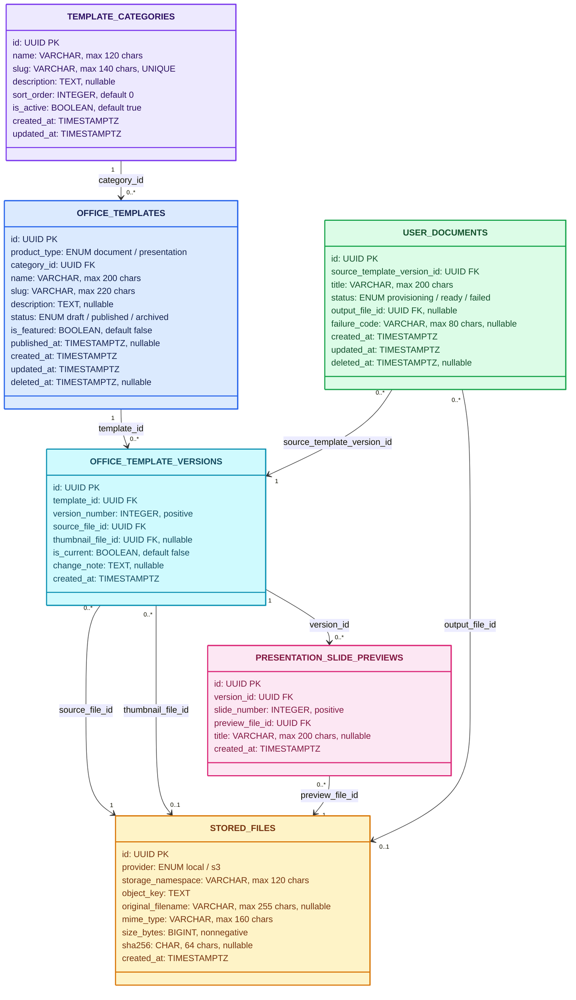

<div align="center">

# Office Template API

API cho hai thư viện mẫu văn bản và mẫu trình chiếu.


</div>

## Mục lục

- [Tổng quan](#tổng-quan)
- [Chạy ứng dụng](#chạy-ứng-dụng)
- [Chạy PostgreSQL và API bằng Docker](#chạy-postgresql-và-api-bằng-docker)
- [API hiện có](#api-hiện-có)
- [Cấu hình môi trường](#cấu-hình-môi-trường)
- [Cấu trúc thư mục](#cấu-trúc-thư-mục)
- [Mô hình dữ liệu](#mô-hình-dữ-liệu)
- [Tính năng và trạng thái](#tính-năng-và-trạng-thái)
- [Lệnh phát triển](#lệnh-phát-triển)

## Tổng quan

Office Template API cung cấp điểm truy cập HTTP cho thư viện mẫu văn bản và thư viện mẫu trình chiếu. Mỗi thư viện là một feature riêng, có controller, application service và kiểu dữ liệu metadata riêng.

API cung cấp thư viện mẫu DOCX với tìm kiếm, lọc danh mục, phân trang, chi tiết và thumbnail. Người dùng có thể tạo một bản DOCX độc lập, tải xuống để chỉnh sửa và tải bản đã sửa lên để lưu; file mẫu gốc được giữ nguyên. Năm mẫu do dự án cung cấp được seed vào PostgreSQL khi chạy Compose hoặc bằng lệnh seed ở môi trường local; mỗi mẫu có file DOCX và ảnh preview WebP trong cùng thư mục.

Các response JSON dùng envelope `{ success, data, meta }`; lỗi dùng `{ success, error, meta }`. Endpoint stream ảnh và DOCX giữ nguyên nội dung nhị phân để trình duyệt hiển thị hoặc tải file.

> [!IMPORTANT]
> API đọc cấu hình từ `api/.env`. `npm ci` tải package từ npm; `npm run build` tạo `dist/`. Docker Compose bind API và PostgreSQL vào loopback của máy, không mở các cổng này ra mạng LAN.

## Chạy ứng dụng

### Yêu cầu

- Node.js `22.x`
- npm
- Docker Engine với Docker Compose v2

### Cài đặt và khởi chạy

```powershell
cd api
npm ci

if (-not (Test-Path .env)) {
    Copy-Item .env.example .env
}

docker compose up -d postgres
npm run migration:run:dev
npm run seed:document-templates:dev
npm run dev
```

Để làm mới toàn bộ dữ liệu nghiệp vụ của PostgreSQL local rồi nạp lại 5 mẫu demo, chạy lệnh riêng:

```powershell
npm run database:reset-and-seed:dev
```

Lệnh này chỉ chấp nhận `NODE_ENV=development` và `DB_HOST=localhost` hoặc loopback. Nó xóa dữ liệu trong sáu bảng nghiệp vụ hiện có, bao gồm tài liệu người dùng và preview trình chiếu, rồi seed lại mẫu DOCX trong cùng transaction. Schema và bảng lịch sử migration được giữ nguyên. Không chạy lệnh này trên database dùng chung hoặc production.

Nếu `.env` đã tồn tại, hãy bổ sung các biến Docker Compose và `DB_*` còn thiếu từ `.env.example`; giữ nguyên các giá trị cấu hình khác.

API chạy tại `http://localhost:3001` theo cấu hình mặc định. Mở `http://localhost:3001/api/docs` để xem tài liệu Swagger UI.

### Kiểm tra nhanh

```powershell
curl.exe http://localhost:3001/api/health
curl.exe http://localhost:3001/api/document-templates
curl.exe http://localhost:3001/api/presentation-templates
```

## Chạy PostgreSQL và API bằng Docker

Từ thư mục `api`, tạo `.env` nếu chưa có rồi khởi động stack:

```powershell
if (-not (Test-Path .env)) {
    Copy-Item .env.example .env
}

$databaseVolume = docker volume ls --format '{{.Name}}'
if ($databaseVolume -notcontains 'office-template-api-postgres-data') {
    docker volume create office-template-api-postgres-data
}

docker compose up --build -d
docker compose ps
```

Compose khởi động PostgreSQL 17, đợi health check thành công, chạy migration và seed 5 mẫu DOCX, rồi mới mở API. PostgreSQL lưu dữ liệu trong volume `office-template-api-postgres-data`; file DOCX người dùng tạo nằm trong volume `office-template-api-files`. Cổng host mặc định là `5432`. API chạy tại `http://localhost:3001` và Swagger tại `http://localhost:3001/api/docs`.

```powershell
docker compose logs -f api
docker compose down
```

`docker compose down` giữ nguyên volume database. Chỉ xóa volume nếu chủ động muốn xóa toàn bộ dữ liệu phát triển; không dùng `down -v` khi cần giữ dữ liệu.

Nếu máy đã dùng cổng `5432` hoặc `3001`, đổi `DB_HOST_PORT` hoặc `API_HOST_PORT` trong `.env` trước khi chạy. Khi chỉ cần PostgreSQL cho API chạy bằng Node trên host:

```powershell
docker compose up -d postgres
npm run migration:run:dev
npm run seed:document-templates:dev
npm run dev
```

## API hiện có

Base URL mặc định: `http://localhost:3001/api`

| Phương thức | Đường dẫn                                   | Mô tả                                          |
| ----------- | ------------------------------------------- | ---------------------------------------------- |
| `GET`       | `/health`                                   | Kiểm tra tiến trình API                        |
| `GET`       | `/document-templates`                       | Tìm kiếm, lọc và phân trang mẫu DOCX           |
| `GET`       | `/document-templates/categories`            | Danh mục và số mẫu đã xuất bản                 |
| `GET`       | `/document-templates/:templateId`           | Chi tiết mẫu và phiên bản hiện hành            |
| `GET`       | `/document-templates/:templateId/preview`   | Stream ảnh thumbnail                           |
| `POST`      | `/document-templates/:templateId/documents` | Tạo bản DOCX riêng từ mẫu                      |
| `GET`       | `/user-documents/:documentId`               | Xem trạng thái và metadata tài liệu đã tạo     |
| `PUT`       | `/user-documents/:documentId/content`       | Lưu DOCX đã chỉnh sửa (multipart field `file`) |
| `GET`       | `/user-documents/:documentId/download`      | Tải DOCX đầu ra                                |
| `GET`       | `/presentation-templates`                   | Liệt kê metadata mẫu trình chiếu               |

`GET /document-templates` nhận `page` (mặc định `1`), `limit` (mặc định `12`, tối đa `100`), `search`, `categoryId` và `featured`. Ví dụ: `GET /api/document-templates?search=bao-cao&categoryId=<uuid>&page=1&limit=12`.

### Mẫu DOCX được seed sẵn

| Danh mục    | Mẫu                                                             |
| ----------- | --------------------------------------------------------------- |
| Bản tin     | Báo truyền thống                                                |
| Bản ghi nhớ | Bản ghi nhớ có góc cạnh và đường cong; Bản ghi nhớ màu xanh lam |
| Ứng tuyển   | Tiêu đề vui vẻ                                                  |
| Sự kiện     | Tờ bướm mời dự tiệc                                             |

Các mẫu cũ được xóa khỏi catalog và metadata file nếu chưa có tài liệu tham chiếu. Mẫu nào đã được dùng để tạo tài liệu sẽ chuyển sang trạng thái lưu trữ để giữ lịch sử nguồn.

Ví dụ response JSON thành công của `GET /health`:

```json
{
    "success": true,
    "data": {
        "status": "ok",
        "timestamp": "2026-10-29T12:00:00.000Z",
        "uptimeSeconds": 42
    },
    "meta": {
        "timestamp": "2026-10-29T12:00:00.000Z",
        "path": "/api/health",
        "method": "GET"
    }
}
```

`timestamp` và `uptimeSeconds` thay đổi theo tiến trình đang chạy. Danh sách mẫu trả `{ items, total, page, limit, totalPages }` trong trường `data`. Endpoint preview và download trả stream file, không bọc envelope JSON.

## Cấu hình môi trường

Tạo `api/.env` từ `.env.example` trước khi chạy ứng dụng:

| Biến                       | Mặc định                    | Mục đích                                          |
| -------------------------- | --------------------------- | ------------------------------------------------- |
| `PORT`                     | `3001`                      | Cổng HTTP API                                     |
| `NODE_ENV`                 | `development`               | Môi trường chạy                                   |
| `WEB_ORIGIN`               | `http://localhost:3000`     | Origin frontend được phép qua CORS                |
| `FILE_STORAGE_ROOT`        | `./storage`                 | Thư mục lưu bản DOCX người dùng tạo               |
| `FILE_STORAGE_ROOT_DOCKER` | `/app/storage`              | Đường dẫn lưu DOCX bên trong API container        |
| `DB_HOST`                  | `localhost`                 | Host PostgreSQL khi API chạy trên máy             |
| `DB_PORT`                  | `5432`                      | Cổng PostgreSQL                                   |
| `DB_USER`                  | `office_template`           | User PostgreSQL local                             |
| `DB_PASSWORD`              | `office_template_local_dev` | Mật khẩu chỉ dùng cho môi trường local            |
| `DB_NAME`                  | `office_template`           | Database local                                    |
| `DB_SSL`                   | `false`                     | Bật SSL khi môi trường PostgreSQL yêu cầu         |
| `DB_LOGGING`               | `false`                     | Ghi SQL query vào log khi cần debug               |
| `DB_HOST_PORT`             | `5432`                      | Cổng máy host được Docker publish cho PostgreSQL  |
| `API_HOST_PORT`            | `3001`                      | Cổng máy host được Docker publish cho API         |
| `FILE_STORAGE_VOLUME_NAME` | `office-template-api-files` | Volume giữ DOCX đầu ra qua lần recreate container |

Không commit `.env`; file này dành cho cấu hình của môi trường phát triển.

`synchronize` luôn tắt. Thay đổi cấu trúc database phải được ghi thành migration rồi mới áp dụng; không bật tự đồng bộ schema trong môi trường phát triển hoặc production.

## Cấu trúc thư mục

```text
api/
├── assets/
│   └── document-templates/             # Mỗi thư mục chứa file.docx và preview.webp
│       ├── Báo truyền thống/
│       ├── Bản ghi nhớ có góc cạnh và đường cong/
│       ├── Bản ghi nhờ màu xanh lam/
│       ├── Tiêu đề vui vẻ/
│       └── Tờ bướm mời dự tiệc/
├── src/
│   ├── bootstrap/
│   │   └── api/
│   │       ├── app.module.ts
│   │       ├── create-api-app.ts
│   │       ├── main.ts
│   ├── http/
│   │   ├── filters/
│   │   │   ├── api-exception.filter.ts
│   │   │   └── api-exception.filter.spec.ts
│   │   └── interceptors/
│   │       ├── response-envelope.interceptor.ts
│   │       └── response-envelope.interceptor.spec.ts
│   ├── database/
│   │   ├── config/
│   │   │   ├── data-source.ts
│   │   │   └── database.options.ts
│   │   ├── seeds/
│   │   │   ├── document-template-samples.seed.ts
│   │   │   └── document-template-samples.seed.spec.ts
│   │   ├── entities/
│   │   │   ├── office-template.entity.ts
│   │   │   ├── office-template-version.entity.ts
│   │   │   ├── presentation-slide-preview.entity.ts
│   │   │   ├── stored-file.entity.ts
│   │   │   ├── template-category.entity.ts
│   │   │   └── user-document.entity.ts
│   │   ├── migrations/
│   │   │   └── 1793376000000-create-office-template-schema.ts
│   │   └── enums/office-template.enums.ts
│   └── modules/
│       ├── health/
│       │   ├── presentation/controllers/health.controller.ts
│       │   └── health.module.ts
│       ├── document-template-library/
│       │   ├── application/
│       │   │   ├── contracts/              # Contract đọc mẫu, đọc/ghi tài liệu và storage
│       │   │   ├── errors/                 # Lỗi nghiệp vụ có HTTP status ổn định
│       │   │   ├── services/
│       │   │   │   ├── catalog/            # List/detail/preview, mỗi use case có folder riêng
│       │   │   │   └── user-documents/     # Create/read/download/save, mỗi use case có folder riêng
│       │   │   ├── types/                  # Kiểu response nội bộ application
│       │   │   └── utils/                  # Projection metadata không lộ storage key
│       │   ├── infrastructure/
│       │   │   ├── repositories/
│       │   │   │   ├── mappers/            # Chuyển TypeORM entity sang application contract
│       │   │   │   ├── read/
│       │   │   │   │   ├── document-templates/ # Đọc catalog mẫu DOCX
│       │   │   │   │   └── user-documents/     # Đọc tài liệu người dùng
│       │   │   │   └── write/              # Transaction tạo/thay file user document
│       │   │   └── storage/local-document-file-storage.ts
│       │   ├── presentation/
│       │   │   ├── controllers/
│       │   │   │   ├── document-templates/
│       │   │   │   │   ├── list-document-templates/          # GET /document-templates
│       │   │   │   │   ├── list-document-template-categories/ # GET /document-templates/categories
│       │   │   │   │   ├── get-document-template/            # GET /document-templates/:templateId
│       │   │   │   │   ├── get-document-template-preview/   # GET /document-templates/:templateId/preview
│       │   │   │   │   └── create-user-document/            # POST /document-templates/:templateId/documents
│       │   │   │   └── user-documents/
│       │   │   │       ├── get-user-document/                # GET /user-documents/:documentId
│       │   │   │       ├── save-user-document-content/      # PUT /user-documents/:documentId/content
│       │   │   │       └── download-user-document/          # GET /user-documents/:documentId/download
│       │   │   ├── dto/                    # Validation cho request HTTP
│       │   │   └── types/uploaded-docx-file.ts
│       │   └── document-template-library.module.ts
│       └── presentation-template-library/
│           ├── application/
│           │   ├── services/list-presentation-templates.service.ts
│           │   └── types/presentation-template-summary.ts
│           ├── presentation/controllers/presentation-templates.controller.ts
│           └── presentation-template-library.module.ts
├── test/
│   └── jest-e2e.json
├── .dockerignore
├── Dockerfile
├── docker-compose.yml
├── .env.example
├── nest-cli.json
├── package.json
└── tsconfig.json
```

`bootstrap/api` giữ composition root, factory cấu hình Nest và entry point của process. `src/http` chứa filter và interceptor dùng chung toàn API; `create-api-app.ts` đăng ký chúng vào request lifecycle, còn mỗi spec nằm cạnh implementation. Trong feature DOCX, controller/DTO thuộc `presentation`; contract, lỗi và use case thuộc `application`; TypeORM read/write repository cùng local file storage thuộc `infrastructure`. Mỗi use case nằm trong folder riêng cạnh spec của nó. Asset nguồn bất biến nằm trong `assets/`; file đầu ra được lưu riêng ở `FILE_STORAGE_ROOT`. Migration đầu tiên tạo sáu bảng metadata; feature mới dùng schema đó và không thêm migration.

Mỗi file Jest mở đầu bằng bảng test case tiếng Việt, sau đó từng test ghi rõ bước Arrange, Act và Assert. Test service mock contract; test TypeORM repository mock query builder/transaction manager; test storage dùng thư mục tạm để kiểm tra bytes và path boundary.

Chạy unit test bằng `npm test -- --runInBand`; chạy coverage bằng `npm run test:cov -- --runInBand`.

## Mô hình dữ liệu

Sơ đồ thể hiện các bảng dự kiến cho hai thư viện mẫu. Các file DOCX, PPTX và ảnh được lưu ở storage; PostgreSQL chỉ lưu metadata cùng khóa tham chiếu tới file.



Mỗi khối là một bảng; field được viết theo dạng `tên_field: kiểu dữ liệu`, sau đó là khóa và ràng buộc như `PK`, `FK`, `UNIQUE`, `nullable`, `default` hoặc giới hạn độ dài. Cardinality ở hai đầu đường nối thể hiện số bản ghi có thể liên kết. `product_type` phân biệt mẫu văn bản và trình chiếu; danh mục có thể dùng chung. Tài liệu được tạo ghim vào phiên bản mẫu đã chọn. Ràng buộc còn gồm slug duy nhất theo loại mẫu, số phiên bản duy nhất trên mỗi mẫu, tối đa một phiên bản hiện hành trên mỗi mẫu, và số slide duy nhất trong mỗi phiên bản.

## Tính năng và trạng thái

| Hạng mục                                                | Trạng thái                |
| ------------------------------------------------------- | ------------------------- |
| NestJS bootstrap, CORS, validation và Swagger           | Đã triển khai             |
| Health check                                            | Đã triển khai             |
| Thư viện mẫu DOCX: tìm kiếm, lọc, phân trang và preview | Đã triển khai, có 5 mẫu   |
| Tạo bản DOCX riêng và tải xuống                         | Đã triển khai             |
| Response envelope thành công và lỗi                     | Đã triển khai toàn API    |
| Endpoint danh mục mẫu trình chiếu                       | Có route, chưa có dữ liệu |
| Entity TypeORM cho mô hình dữ liệu                      | Đã triển khai             |
| Kết nối PostgreSQL và migration                         | Đã triển khai             |
| Chỉnh sửa nội dung bằng editor nhúng                    | Chưa triển khai           |
| Tạo bản sao và tải xuống PPTX                           | Chưa triển khai           |

Editor nhúng phía trình duyệt chưa được tích hợp; API đã nhận file DOCX đã sửa qua `PUT /user-documents/:documentId/content`, còn giao diện sẽ kết nối luồng này ở bước frontend. Tài liệu hiện được tra cứu bằng UUID; phân quyền theo tài khoản chưa nằm trong phạm vi MVP vì hệ thống chưa có xác thực người dùng.

## Lệnh phát triển

Chạy trong thư mục `api`:

| Lệnh                                  | Mục đích                                              |
| ------------------------------------- | ----------------------------------------------------- |
| `npm run dev`                         | Chạy NestJS ở chế độ watch                            |
| `npm run build`                       | Build API và viết lại alias cho runtime               |
| `npm run start:prod`                  | Chạy ứng dụng đã build trong `dist/`                  |
| `npm run migration:show:dev`          | Xem migration đã áp dụng và còn chờ                   |
| `npm run seed:document-templates:dev` | Seed 5 mẫu DOCX và dọn bộ demo cũ một cách idempotent |
| `npm run database:reset-and-seed:dev` | Xóa dữ liệu nghiệp vụ local rồi seed lại 5 mẫu demo   |
| `npm run migration:run:dev`           | Áp dụng migration lên PostgreSQL local                |
| `npm run migration:revert:dev`        | Hoàn tác migration mới nhất                           |
| `npm run type-check`                  | Kiểm tra kiểu TypeScript                              |
| `npm run lint`                        | Kiểm tra source bằng ESLint                           |

Tạo migration mới sau khi sửa entity bằng lệnh:

```powershell
npm run migration:generate:dev -- src/database/migrations/DescribeSchemaChange
```

Review migration đã sinh trước khi chạy `npm run migration:run:dev`. Không sửa migration đã áp dụng; tạo migration tiếp theo để thay đổi schema.

## Tích hợp frontend

Frontend hiện đặt `VITE_API_BASE_URL` mặc định là `http://localhost:3001/api`, nhưng chưa gửi request tới API. Khi kết nối được triển khai, hai danh mục sẽ được tải qua các endpoint tương ứng ở trên.

## Giấy phép

Package API đang được đánh dấu `UNLICENSED`; chưa có giấy phép sử dụng công khai.
