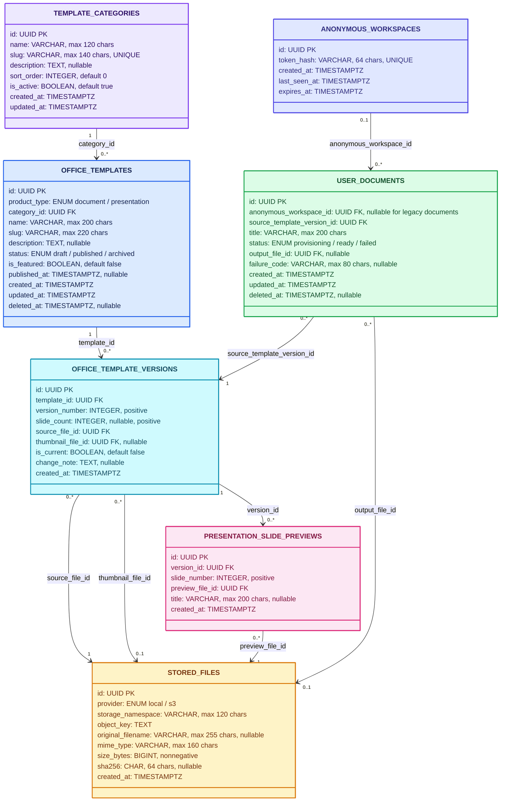

<div align="center">

# Office Template API

API cho hai thư viện mẫu văn bản và mẫu trình chiếu.


</div>

## Mục lục

- [Tổng quan](#tổng-quan)
- [Công nghệ](#công-nghệ)
- [Thư viện bên thứ ba và giấy phép](#thư-viện-bên-thứ-ba-và-giấy-phép)
- [Khai báo sử dụng AI](#khai-báo-sử-dụng-ai)
- [Chạy backend bằng Docker Compose](#chạy-backend-bằng-docker-compose)
- [Chạy API trên máy phát triển](#chạy-api-trên-máy-phát-triển)
- [API hiện có](#api-hiện-có)
- [Cấu hình môi trường](#cấu-hình-môi-trường)
- [Cấu trúc thư mục](#cấu-trúc-thư-mục)
- [Mô hình dữ liệu](#mô-hình-dữ-liệu)
- [Tính năng và trạng thái](#tính-năng-và-trạng-thái)
- [Lệnh phát triển](#lệnh-phát-triển)

## Tổng quan

Office Template API cung cấp điểm truy cập HTTP cho thư viện mẫu văn bản và thư viện mẫu trình chiếu. Mỗi thư viện có controller, application service và kiểu dữ liệu metadata riêng; vòng đời tài liệu do người dùng tạo nằm trong `UserDocumentManagementModule` độc lập.

API cung cấp thư viện mẫu DOCX và PPTX với tìm kiếm, lọc danh mục, chi tiết và ảnh xem trước. Người dùng có thể tạo bản sao độc lập, chỉnh sửa DOCX/PPTX qua ONLYOFFICE và tải file đã lưu xuống; file mẫu gốc luôn được giữ nguyên. Seed ghi metadata và checksum vào PostgreSQL; asset mẫu được đóng gói trong `assets/`, còn file người dùng tạo nằm trong storage bền vững riêng.

Docker Compose là cách chạy backend được khuyến nghị: PostgreSQL, job migration/seed, NestJS API và ONLYOFFICE Docs được khởi động trong cùng network. API trong container chạy bản build production; PostgreSQL dùng Docker volume, còn file người dùng được bind mount từ `api/storage` trên host.

Các response JSON thông thường dùng envelope `{ success, data, meta }`; lỗi dùng `{ success, error, meta }`. Endpoint stream file Office/ảnh và callback ONLYOFFICE giữ contract riêng, không chuyển thành envelope JSON dùng cho API client.

> [!IMPORTANT]
> Docker Compose đọc biến từ `api/.env`; `.env` không được đưa vào image. Các cổng host mặc định chỉ bind vào `127.0.0.1`. Không dùng mật khẩu mẫu hoặc JWT secret mặc định khi mở dịch vụ ra ngoài máy phát triển.

## Công nghệ

Các phiên bản dưới đây đối chiếu với `package.json`, `.env.example` và Docker Compose.

| Thành phần | Công nghệ / phiên bản                                 | Vai trò                                                     |
| ---------- | ----------------------------------------------------- | ----------------------------------------------------------- |
| Container  | Docker multi-stage, Compose v2, Node `22-alpine`      | Đóng gói API và chạy PostgreSQL, migration, API, ONLYOFFICE |
| Runtime    | Node.js `22.x`, TypeScript `^5.7.3`                   | Chạy và biên dịch backend                                   |
| HTTP API   | NestJS `11`, Express adapter                          | Controller, dependency injection và validation              |
| Validation | `class-validator ^0.15.1`, `class-transformer ^0.5.1` | Parse, transform và validate DTO request                    |
| Database   | PostgreSQL `17-alpine` trong Compose                  | Lưu catalog, workspace và metadata tài liệu                 |
| ORM        | TypeORM `^1.1.2`, PostgreSQL driver `pg ^8.23.1`      | Entity, repository và migration                             |
| API docs   | `@nestjs/swagger ^11.4.7`                             | OpenAPI và Swagger UI tại `/api/docs`                       |
| Editor     | ONLYOFFICE Docs `10.0.0`                              | Chỉnh sửa DOCX/PPTX và callback lưu                         |
| Unit test  | Jest `^30`                                            | Kiểm tra service, repository, storage và seed               |

Backend dùng TypeORM với PostgreSQL; `synchronize` luôn tắt. Entity nằm trong `src/database/entities`, enum persistence trong `src/database/enums`, migration trong `src/database/migrations`. Thay đổi schema phải đi qua migration đã review.

## Thư viện bên thứ ba và giấy phép

Danh sách gồm dependency trực tiếp của API trong `dependencies` và `devDependencies`. Giấy phép lấy từ metadata của phiên bản đã cài; `package-lock.json` khóa phiên bản sử dụng. Dependency bắc cầu không liệt kê riêng ở đây.

### Runtime

- **MIT:** `@nestjs/bullmq`, `@nestjs/common`, `@nestjs/core`, `@nestjs/jwt`, `@nestjs/platform-express`, `@nestjs/swagger`, `@nestjs/typeorm`, `bullmq`, `class-transformer`, `class-validator`, `ioredis`, `pg`, `swagger-ui-express`, `typeorm`.
- **Apache-2.0:** `reflect-metadata`, `rxjs`.

### Công cụ phát triển và kiểm thử

- **MIT:** `@eslint/eslintrc`, `@eslint/js`, `@nestjs/cli`, `@nestjs/schematics`, `@nestjs/testing`, `@types/express`, `@types/jest`, `@types/node`, `@types/pg`, `@types/supertest`, `@types/swagger-ui-express`, `eslint`, `eslint-config-prettier`, `eslint-plugin-prettier`, `globals`, `jest`, `prettier`, `source-map-support`, `supertest`, `ts-jest`, `ts-loader`, `ts-node`, `tsc-alias`, `tsconfig-paths`, `typescript-eslint`.
- **Apache-2.0:** `typescript`.

### Dịch vụ runtime

- **PostgreSQL 17:** PostgreSQL License ([điều khoản chính thức](https://www.postgresql.org/about/licence/)).
- **ONLYOFFICE Docs Community 10.0.0:** AGPL v3 ([điều khoản chính thức](https://www.onlyoffice.com/legalterms)).

## Khai báo sử dụng AI

Dự án có sử dụng **OpenAI Codex với model GPT-6 Luna** để hỗ trợ phân tích yêu cầu, đề xuất cấu trúc, viết và chỉnh sửa mã nguồn/tài liệu, cũng như phân tích lỗi. Người thực hiện chịu trách nhiệm rà soát kết quả và quyết định nội dung bàn giao.

## Chạy backend bằng Docker Compose

### Bước 1: Tạo cấu hình local

Mở **Git Bash tại thư mục gốc repo** `Office Template Platform/`, rồi chạy:

```bash
cd api
if [ ! -f .env ]; then cp .env.example .env; fi
docker volume create office-template-api-postgres-data
```

Nếu đã đổi `DB_VOLUME_NAME` trong `.env`, tạo volume theo tên mới.

Các bước tiếp theo cũng chạy trong cùng terminal tại thư mục `api/`.

### Bước 2: Build và chạy các service

```bash
docker compose up --build -d
docker compose ps
```

Compose tự build API, khởi động PostgreSQL và ONLYOFFICE, rồi chạy migration/seed trước API. `migrate` hiện `Exited (0)` nghĩa là đã chạy xong thành công.

### Bước 3: Kiểm tra API

```bash
curl http://localhost:3001/api/health
```

Swagger: `http://localhost:3001/api/docs`. ONLYOFFICE Docs: `http://localhost:8082`. Nếu đổi port trong `.env`, dùng port mới đã cấu hình.

### Bước 4: Xem log hoặc dừng

```bash
docker compose logs --tail=100 api
docker compose down
```

`docker compose down` giữ database trong Docker volume và giữ file người dùng tại `api/storage` trên host.

### Tùy chọn: Reset dữ liệu local

Lệnh này xóa dữ liệu nghiệp vụ trong PostgreSQL rồi seed lại mẫu. Chỉ chạy với `.env` local (`NODE_ENV=development`, `DB_HOST=localhost`); file trong storage không bị xóa.

```bash
docker compose stop api
npm run database:reset-and-seed:dev
docker compose start api
```

## Chạy API trên máy phát triển

Sau Bước 1 ở trên, nếu muốn chạy riêng API trên máy (Node.js `22.x`) còn PostgreSQL và ONLYOFFICE chạy bằng Docker:

```bash
npm ci
docker compose up -d postgres onlyoffice
npm run migration:run:dev
npm run seed:office-templates:dev
npm run dev
```

Trong chế độ này, TypeORM kết nối PostgreSQL qua `DB_HOST=localhost`; API mặc định chạy tại `http://localhost:3001`.

## API hiện có

Base URL mặc định: `http://localhost:3001/api`

| Phương thức | Đường dẫn                                                         | Mô tả                                                |
| ----------- | ----------------------------------------------------------------- | ---------------------------------------------------- |
| `GET`       | `/health`                                                         | Kiểm tra tiến trình API                              |
| `GET`       | `/document-templates`                                             | Tìm kiếm, lọc và phân trang mẫu DOCX                 |
| `GET`       | `/document-templates/categories`                                  | Danh mục và số mẫu đã xuất bản                       |
| `GET`       | `/document-templates/:templateId`                                 | Chi tiết mẫu và phiên bản hiện hành                  |
| `GET`       | `/document-templates/:templateId/preview`                         | Stream ảnh thumbnail                                 |
| `POST`      | `/document-templates/:templateId/documents`                       | Tạo bản DOCX riêng từ mẫu                            |
| `GET`       | `/user-documents`                                                 | Liệt kê tài liệu của workspace hiện tại              |
| `GET`       | `/user-documents/trash/items`                                     | Liệt kê tài liệu đã xóa mềm để khôi phục             |
| `GET`       | `/user-documents/:documentId`                                     | Xem trạng thái và metadata tài liệu đã tạo           |
| `GET`       | `/user-documents/:documentId/editor-config`                       | Lấy cấu hình mở lại tài liệu Office trong ONLYOFFICE |
| `GET`       | `/user-documents/:documentId/editor-file?token=...`               | Cấp revision có chữ ký cho ONLYOFFICE Docs           |
| `PUT`       | `/user-documents/:documentId/content`                             | Lưu DOCX/PPTX đã chỉnh sửa (multipart field `file`)  |
| `GET`       | `/user-documents/:documentId/download`                            | Tải DOCX/PPTX đầu ra                                 |
| `DELETE`    | `/user-documents/:documentId`                                     | Đưa tài liệu vào thùng rác; giữ nguyên file          |
| `PATCH`     | `/user-documents/:documentId/restore`                             | Khôi phục tài liệu từ thùng rác                      |
| `POST`      | `/user-documents/:documentId/onlyoffice-callback`                 | Nhận callback lưu có JWT từ ONLYOFFICE Docs          |
| `GET`       | `/presentation-templates`                                         | Liệt kê metadata mẫu trình chiếu                     |
| `GET`       | `/presentation-templates/categories`                              | Danh mục và số mẫu trình chiếu                       |
| `GET`       | `/presentation-templates/:templateId`                             | Chi tiết mẫu và các slide có ảnh preview             |
| `GET`       | `/presentation-templates/:templateId/preview`                     | Stream ảnh thumbnail bộ PPTX                         |
| `GET`       | `/presentation-templates/:templateId/slides/:slideNumber/preview` | Stream ảnh preview của một slide                     |
| `POST`      | `/presentation-templates/:templateId/documents`                   | Tạo bản PPTX riêng trong workspace                   |

`GET /document-templates` nhận `page` (mặc định `1`), `limit` (mặc định `12`, tối đa `100`), `search`, `categoryId` và `featured`. `GET /presentation-templates` nhận `search` và `categoryId`, đồng thời giữ response dạng mảng tương thích catalog hiện tại. Ví dụ: `GET /api/document-templates?search=bao-cao&categoryId=<uuid>&page=1&limit=12`.

Các endpoint quản lý tài liệu và tạo bản sao dùng cookie `office_template_workspace`; frontend phải gửi credentials để browser giữ cookie. `editor-file` chỉ cấp revision khi query token hợp lệ. Callback ONLYOFFICE được xác thực bằng JWT `Authorization` riêng và trả `{ "error": 0 }` theo contract của Docs Server, không dùng response envelope chung. Các endpoint preview/download trả bytes của file thay vì JSON.

### Tài liệu theo thiết bị khi chưa có đăng nhập

API cấp cookie `office_template_workspace` dạng `HttpOnly` cho hồ sơ trình duyệt ở lần đầu gọi API tạo hoặc đọc tài liệu. PostgreSQL chỉ lưu SHA-256 của token; API gắn mỗi tài liệu mới với workspace đó và giới hạn danh sách, metadata, tải xuống, cấu hình editor, upload, xóa và khôi phục theo cùng owner. `GET /user-documents` nhận `page` (mặc định `1`), `limit` (mặc định `12`, tối đa `100`) và `search`; danh sách sắp theo `updatedAt` giảm dần để mở lại tài liệu vừa chỉnh.

`DELETE /user-documents/:documentId` chỉ đặt `deleted_at`; API giữ nguyên bản ghi, metadata `stored_files` và file vật lý để có thể khôi phục. Dùng `GET /user-documents/trash/items` để tìm tài liệu đã xóa, rồi gọi `PATCH /user-documents/:documentId/restore`; các API này vẫn bị giới hạn bởi cookie workspace. Tài liệu trong thùng rác không có URL tải hoạt động cho tới khi được khôi phục. Nếu file đã bị xóa vật lý trước thay đổi này, restore trả `409 Conflict` và giữ tài liệu trong thùng rác.

Để mở lại tài liệu, client lấy `id` từ danh sách rồi gọi `GET /user-documents/:documentId/editor-config`; API chỉ trả cấu hình editor khi ID thuộc workspace hiện tại. ONLYOFFICE tải revision theo URL có chữ ký và lưu bản cuối qua callback đã xác thực JWT.

Workspace đại diện cho một hồ sơ trình duyệt trên máy chạy frontend, không phải tài khoản hoặc đường dẫn lưu trên ổ đĩa của người dùng. Cookie và record được gia hạn thêm 400 ngày mỗi khi workspace hoạt động. Xóa cookie, đổi browser profile hoặc hết hạn cookie sau 400 ngày không hoạt động sẽ mất quyền truy cập workspace đó; file vẫn nằm trong thư mục `api/storage` của host. Tài liệu tạo trước migration chưa có owner sẽ được gắn cho workspace đầu tiên mở lại tài liệu bằng URL/ID cũ; sau đó workspace khác chỉ nhận 404.

Khi frontend và API có origin khác nhau, browser client cần gửi credentials (`credentials: 'include'`) để nhận và gửi cookie; CORS chỉ chấp nhận `WEB_ORIGIN` đã cấu hình và cho phép credentials. Callback ONLYOFFICE không dùng cookie này: callback tiếp tục xác thực JWT riêng và khóa ghi theo revision file.

### Mẫu DOCX được seed sẵn

| Danh mục    | Mẫu                                                             |
| ----------- | --------------------------------------------------------------- |
| Bản tin     | Báo truyền thống                                                |
| Bản ghi nhớ | Bản ghi nhớ có góc cạnh và đường cong; Bản ghi nhớ màu xanh lam |
| Ứng tuyển   | Tiêu đề vui vẻ                                                  |
| Sự kiện     | Tờ bướm mời dự tiệc; Phiếu quà tặng ngày lễ                     |
| Báo cáo     | Báo cáo                                                         |
| Kinh doanh  | Hóa đơn dịch vụ                                                 |
| Giáo dục    | Lịch công tác Hội phụ huynh giáo viên                           |

### Mẫu PPTX được seed sẵn

| Bộ mẫu                              | Số slide | Danh mục          |
| ----------------------------------- | -------: | ----------------- |
| Bản trình bày phổ biến              |       14 | Kinh doanh        |
| Chứng chỉ đào tạo                   |        1 | Giáo dục          |
| Chứng nhận học bổng                 |        1 | Giáo dục          |
| Giải thưởng nhân viên xuất sắc      |        1 | Chứng nhận        |
| Giấy chứng nhận nhân viên của tháng |        1 | Chứng nhận        |
| Sách nhỏ quảng cáo màu vàng         |        4 | Kinh doanh        |
| Sơ đồ tổ chức đơn giản              |        1 | Sơ đồ & tổ chức   |
| Thiết kế giọt nước                  |       14 | Thiết kế sáng tạo |
| Thiết kế máy tính bảng              |        2 | Giáo dục          |

Seed đồng bộ 9 bộ PPTX có `file.pptx`, `preview.png` và ảnh riêng cho từng slide tại `slides/slide-NNN.png`. Ảnh `preview.png` dùng làm thumbnail catalog; seed tạo một bản ghi `presentation_slide_previews` cho mỗi ảnh, còn `slideCount` là tổng số slide trong file PPTX.

Các mẫu cũ được xóa khỏi catalog và metadata file nếu chưa có tài liệu tham chiếu. Mẫu nào đã được dùng để tạo tài liệu sẽ chuyển sang trạng thái lưu trữ để giữ lịch sử nguồn.

Ví dụ response JSON thành công của `GET /health`:

```json
{
    "success": true,
    "data": {
        "status": "ok",
        "timestamp": "2026-10-29T12:00:00.000Z",
        "uptimeSeconds": 42
    },
    "meta": {
        "timestamp": "2026-10-29T12:00:00.000Z",
        "path": "/api/health",
        "method": "GET"
    }
}
```

`timestamp` và `uptimeSeconds` thay đổi theo tiến trình đang chạy. Danh sách mẫu trả `{ items, total, page, limit, totalPages }` trong trường `data`. Endpoint preview và download trả stream file, không bọc envelope JSON.

## Cấu hình môi trường

Tạo `api/.env` từ `.env.example`. Bảng dưới ghi các giá trị local mặc định; `.env.example` là nguồn đầy đủ khi Compose yêu cầu thêm biến.

| Nhóm       | Biến                          | Giá trị mặc định                       | Ý nghĩa                                                                    |
| ---------- | ----------------------------- | -------------------------------------- | -------------------------------------------------------------------------- |
| Runtime    | `PORT`                        | `3001`                                 | Cổng API bên trong container và khi chạy API trên host                     |
| Runtime    | `API_HOST_PORT`               | `3001`                                 | Cổng host publish tới API container                                        |
| Runtime    | `NODE_ENV`                    | `development`                          | Môi trường cho scripts chạy trên host                                      |
| Runtime    | `API_NODE_ENV`                | `production`                           | Môi trường truyền vào API và migration container                           |
| Runtime    | `WEB_ORIGIN`                  | `http://localhost:3000`                | Origin được phép CORS; credentials được bật cho workspace cookie           |
| Runtime    | `API_URL`                     | `http://localhost:3001/api`            | URL hiển thị trong startup banner; API có thể tự dựng từ `PORT`            |
| Compose    | `COMPOSE_PROJECT_NAME`        | `office-template-platform`             | Tên project trong Docker Compose                                           |
| Compose    | `COMPOSE_NETWORK_NAME`        | `office-template-platform-network`     | Network riêng giữa API, PostgreSQL, migration và ONLYOFFICE                |
| Compose    | `CONTAINER_BIND_ADDRESS`      | `127.0.0.1`                            | Chỉ publish các cổng host trên loopback                                    |
| Compose    | `API_IMAGE`                   | `office-template-api:local`            | Tên image được build từ `Dockerfile`                                       |
| Compose    | `POSTGRES_IMAGE`              | `postgres:17-alpine`                   | Image PostgreSQL local                                                     |
| Compose    | `API_CONTAINER_NAME`          | `api`                                  | Tên container API                                                          |
| Compose    | `POSTGRES_CONTAINER_NAME`     | `postgres`                             | Tên container PostgreSQL                                                   |
| Compose    | `MIGRATE_CONTAINER_NAME`      | `migrate`                              | Tên job migration/seed                                                     |
| Database   | `DB_HOST`                     | `localhost`                            | Host dùng khi API/CLI TypeORM chạy trên máy                                |
| Database   | `DB_HOST_DOCKER`              | `postgres`                             | DNS service dùng bởi API và job trong Compose                              |
| Database   | `DB_PORT`                     | `5432`                                 | Cổng PostgreSQL bên trong network và cổng TypeORM dùng                     |
| Database   | `DB_HOST_PORT`                | `5432`                                 | Cổng PostgreSQL publish trên host                                          |
| Database   | `DB_NAME`                     | `office_template`                      | Tên database local                                                         |
| Database   | `DB_USER`                     | `office_template`                      | User PostgreSQL local                                                      |
| Database   | `DB_PASSWORD`                 | `office_template_local_dev`            | Mật khẩu phát triển; thay bằng secret riêng khi cần                        |
| Database   | `DB_SSL`                      | `false`                                | Bật SSL cho TypeORM khi PostgreSQL yêu cầu                                 |
| Database   | `DB_LOGGING`                  | `false`                                | Bật log query TypeORM để debug                                             |
| Database   | `DB_VOLUME_NAME`              | `office-template-api-postgres-data`    | External volume giữ database qua lần recreate                              |
| Database   | `DATABASE_URL`                | PostgreSQL local                       | Biến tiện dụng cho công cụ ngoài; TypeORM hiện đọc `DB_*`                  |
| Storage    | `FILE_STORAGE_ROOT`           | `./storage`                            | Thư mục host; Compose bind mount vào `/app/storage`                        |
| Storage    | `FILE_STORAGE_ROOT_DOCKER`    | `/app/storage`                         | Root storage bên trong API container                                       |
| ONLYOFFICE | `ONLYOFFICE_IMAGE`            | `onlyoffice/documentserver:10.0.0`     | Image Docs Server                                                          |
| ONLYOFFICE | `ONLYOFFICE_CONTAINER_NAME`   | `onlyoffice-docs`                      | Tên container Docs Server                                                  |
| ONLYOFFICE | `ONLYOFFICE_HOST_PORT`        | `8082`                                 | Cổng host truy cập Docs Server từ trình duyệt                              |
| ONLYOFFICE | `ONLYOFFICE_PUBLIC_URL`       | `http://localhost:8082`                | URL trình duyệt dùng để tải editor script                                  |
| ONLYOFFICE | `ONLYOFFICE_INTERNAL_URL`     | `http://localhost:8082`                | Origin API dùng để tải file kết quả; Compose đổi thành `http://onlyoffice` |
| ONLYOFFICE | `ONLYOFFICE_API_INTERNAL_URL` | `http://host.docker.internal:3001/api` | URL Docs Server gọi API; Compose đổi sang DNS `api`                        |
| ONLYOFFICE | `ONLYOFFICE_JWT_SECRET`       | Placeholder trong `.env.example`       | Secret phải khớp giữa API và Docs Server                                   |
| Tùy chọn   | `REDIS_URL`                   | `redis://localhost:6379`               | Chưa được API hoặc Compose sử dụng                                         |

Compose đưa biến cần thiết vào container thay vì đóng gói `.env` vào image. Không tái sử dụng mật khẩu hoặc JWT secret mẫu cho môi trường công khai.

`synchronize` luôn tắt. Thay đổi cấu trúc database phải được ghi thành migration rồi mới áp dụng; không bật tự đồng bộ schema trong môi trường phát triển hoặc production.

## Cấu trúc thư mục

```text
api/
├── assets/
│   ├── document-templates/<slug>/      # file.docx và preview.webp của từng mẫu
│   └── presentation-templates/<slug>/  # file.pptx và preview.png của từng mẫu
├── src/
│   ├── bootstrap/api/                  # Composition root, cấu hình HTTP và entry point
│   ├── http/
│   │   ├── filters/                    # Chuẩn hóa lỗi API
│   │   └── interceptors/               # Response envelope JSON
│   ├── database/
│   │   ├── config/                      # TypeORM DataSource và database options
│   │   ├── entities/                    # Bảy TypeORM entity hiện tại
│   │   ├── enums/                       # Enum lưu trong PostgreSQL
│   │   ├── migrations/                  # Ba migration đã đăng ký
│   │   └── seeds/                       # Catalog mẫu DOCX/PPTX
│   ├── integrations/onlyoffice/         # Docs Server client, module và callback types
│   └── modules/
│       ├── health/                      # Health endpoint
│       ├── document-file-storage/       # Contract và adapter lưu file local
│       ├── document-template-library/   # Catalog mẫu DOCX
│       ├── presentation-template-library/ # Catalog mẫu PPTX và tạo presentation
│       └── user-document-management/    # Workspace và vòng đời tài liệu người dùng
├── test/
│   └── jest-e2e.json
├── storage/                             # Runtime storage; Docker bind mount thư mục host này vào API
├── .dockerignore
├── Dockerfile
├── docker-compose.yml
├── .env.example
├── nest-cli.json
├── package.json
└── tsconfig.json
```

`bootstrap/api` là composition root; `http` đăng ký filter và interceptor dùng chung; `integrations/onlyoffice` cô lập giao tiếp với Docs Server. Các feature chia ranh giới `application`, `presentation` và `infrastructure`. PostgreSQL chỉ lưu metadata và tham chiếu file; local storage giữ bytes. File đầu ra mới nằm trong `user-documents/` cho DOCX và `user-presentations/` cho PPTX. Các PPTX được tạo trước khi tách namespace vẫn đọc được từ `user-documents/`.

Mỗi file Jest mở đầu bằng bảng test case tiếng Việt, sau đó từng test ghi rõ bước Arrange, Act và Assert. Test service mock contract; test TypeORM repository mock query builder/transaction manager; test storage dùng thư mục tạm để kiểm tra bytes và path boundary.

Chạy unit test bằng `npm test -- --runInBand`; chạy coverage bằng `npm run test:cov -- --runInBand`.

## Mô hình dữ liệu

Sơ đồ dưới đây mô tả schema PostgreSQL đang được dùng bởi bảy TypeORM entity và ba migration trong `src/database`. PostgreSQL lưu metadata và khóa tham chiếu; bytes của DOCX, PPTX và ảnh nằm trong local file storage.



Mỗi khối là một bảng; field được viết theo dạng `tên_field: kiểu dữ liệu`, sau đó là khóa và ràng buộc như `PK`, `FK`, `UNIQUE`, `nullable`, `default` hoặc giới hạn độ dài. Cardinality ở hai đầu đường nối thể hiện số bản ghi có thể liên kết.

| Entity / bảng                                              | Trách nhiệm                                                                                                                                               |
| ---------------------------------------------------------- | --------------------------------------------------------------------------------------------------------------------------------------------------------- |
| `TemplateCategory` / `template_categories`                 | Danh mục dùng chung cho mẫu DOCX và PPTX; slug duy nhất, có cờ bật/tắt và thứ tự hiển thị.                                                                |
| `OfficeTemplate` / `office_templates`                      | Metadata mẫu trong catalog, phân biệt bằng `product_type`; hỗ trợ trạng thái xuất bản, nổi bật và xóa mềm.                                                |
| `OfficeTemplateVersion` / `office_template_versions`       | Phiên bản nguồn bất biến; ghim file nguồn, thumbnail tùy chọn, ghi chú thay đổi và số slide tùy loại mẫu.                                                 |
| `PresentationSlidePreview` / `presentation_slide_previews` | Liên kết ảnh xem trước với số slide cụ thể của một phiên bản PPTX.                                                                                        |
| `StoredFile` / `stored_files`                              | Metadata về vị trí, định dạng, kích thước và checksum; không chứa bytes file. Enum nhận `local` và `s3`, còn adapter hiện được cấu hình là local storage. |
| `UserDocument` / `user_documents`                          | Bản sao DOCX/PPTX độc lập, giữ liên kết tới phiên bản mẫu nguồn, workspace sở hữu và file đầu ra; `deleted_at` dùng cho thùng rác/khôi phục.              |
| `AnonymousWorkspace` / `anonymous_workspaces`              | Danh tính ẩn danh theo hồ sơ trình duyệt; database chỉ lưu hash token, không lưu token cookie gốc.                                                        |

`OfficeTemplateProductType` gồm `document` và `presentation`; `OfficeTemplateStatus` gồm `draft`, `published`, `archived`; `UserDocumentStatus` gồm `provisioning`, `ready`, `failed`. Các khóa ngoại dùng `ON DELETE RESTRICT` để không xóa nhầm dữ liệu còn được tham chiếu. Slug mẫu duy nhất theo loại sản phẩm chỉ áp dụng cho mẫu chưa xóa; mỗi mẫu có số phiên bản duy nhất và tối đa một phiên bản hiện hành; mỗi slide chỉ có một preview trong một phiên bản. `anonymous_workspace_id` nullable để tương thích tài liệu cũ chưa có owner; khi được mở lại lần đầu, service có thể gắn tài liệu đó vào workspace hiện tại.

| Migration                                         | Thay đổi schema                                                                                             |
| ------------------------------------------------- | ----------------------------------------------------------------------------------------------------------- |
| `1793376000000-create-office-template-schema`     | Tạo enum và sáu bảng nền cho danh mục, mẫu, phiên bản, file metadata, slide preview và tài liệu người dùng. |
| `1793380800000-add-anonymous-document-workspaces` | Tạo `anonymous_workspaces` và thêm quan hệ workspace nullable cho `user_documents`.                         |
| `1793384400000-add-presentation-slide-count`      | Thêm `slide_count` nullable cùng kiểm tra giá trị dương; DOCX không có số slide nên để `NULL`.              |

TypeORM `synchronize` và tự chạy migration lúc boot đều tắt. Vì vậy cần áp dụng migration trước khi API khởi động; Docker Compose thực hiện việc này trong service `migrate`.

## Tính năng và trạng thái

| Hạng mục                                                 | Trạng thái                                  |
| -------------------------------------------------------- | ------------------------------------------- |
| NestJS bootstrap, CORS, validation và Swagger            | Đã triển khai                               |
| Health check                                             | Đã triển khai                               |
| Thư viện mẫu DOCX: tìm kiếm, lọc, phân trang và preview  | Đã triển khai                               |
| Tạo bản DOCX riêng và tải xuống                          | Đã triển khai                               |
| Workspace ẩn danh, giới hạn tài liệu theo trình duyệt    | Đã triển khai phía API                      |
| Danh sách tài liệu và mở lại tài liệu đã lưu             | Đã triển khai phía API                      |
| Lưu DOCX/PPTX qua callback ONLYOFFICE                    | Có luồng; cần xác nhận cấu hình Docs Server |
| Response envelope thành công và lỗi                      | Đã triển khai toàn API                      |
| Entity TypeORM cho mô hình dữ liệu                       | Đã triển khai                               |
| Kết nối PostgreSQL và migration                          | Đã triển khai                               |
| Chỉnh sửa nội dung bằng editor nhúng                     | Đã tích hợp; cần Docs Server hoạt động đúng |
| Thư viện mẫu PPTX: tìm kiếm, danh mục, detail và preview | Đã triển khai, có 9 bộ mẫu                  |
| Tạo, chỉnh sửa và tải bản PPTX độc lập                   | Đã triển khai qua workspace thiết bị        |
| Xóa mềm, xem thùng rác và khôi phục theo workspace       | Đã triển khai; file vẫn được giữ            |

ONLYOFFICE callback thay bản DOCX/PPTX hiện hành sau khi nhận callback lưu cuối `status: 2`; API cũng có `PUT /user-documents/:documentId/content` cho luồng upload trực tiếp. Bản cũ bị thay thế nên API hiện mở lại bản đã lưu gần nhất, chưa giữ lịch sử phiên bản. Người dùng chưa có tài khoản; cookie workspace giới hạn dữ liệu theo hồ sơ trình duyệt và không đồng bộ giữa máy.

## Lệnh phát triển

Chạy trong thư mục `api`:

| Lệnh                                  | Mục đích                                             |
| ------------------------------------- | ---------------------------------------------------- |
| `npm run dev`                         | Chạy NestJS ở chế độ watch                           |
| `npm run build`                       | Build API và viết lại alias cho runtime              |
| `npm run start:prod`                  | Chạy ứng dụng đã build trong `dist/`                 |
| `npm run migration:show:dev`          | Xem migration đã áp dụng và còn chờ                  |
| `npm run seed:office-templates:dev`   | Seed catalog DOCX/PPTX theo cách idempotent          |
| `npm run database:reset-and-seed:dev` | Xóa dữ liệu nghiệp vụ local rồi seed lại hai catalog |
| `npm run migration:run:dev`           | Áp dụng migration lên PostgreSQL local               |
| `npm run migration:revert:dev`        | Hoàn tác migration mới nhất                          |
| `npm run type-check`                  | Kiểm tra kiểu TypeScript                             |
| `npm run lint`                        | Kiểm tra source bằng ESLint                          |

Tạo migration mới sau khi sửa entity bằng lệnh:

Chạy lệnh từ thư mục `api/`:

```bash
npm run migration:generate:dev -- src/database/migrations/DescribeSchemaChange
```

Review migration đã sinh trước khi chạy `npm run migration:run:dev`. Không sửa migration đã áp dụng; tạo migration tiếp theo để thay đổi schema.

## Tích hợp frontend

Frontend hiện dùng RTK Query để gọi các API catalog, workspace tài liệu và presentation; `VITE_API_BASE_URL` mặc định là `http://localhost:3001/api`. Nếu đổi `API_HOST_PORT`, cấu hình biến này trong `web/.env` theo URL mà trình duyệt truy cập được. API bật CORS cho `WEB_ORIGIN` và credentials để cookie workspace hoạt động; khi dùng origin khác, cả `WEB_ORIGIN` lẫn `VITE_API_BASE_URL` phải khớp địa chỉ frontend/API thực tế.
